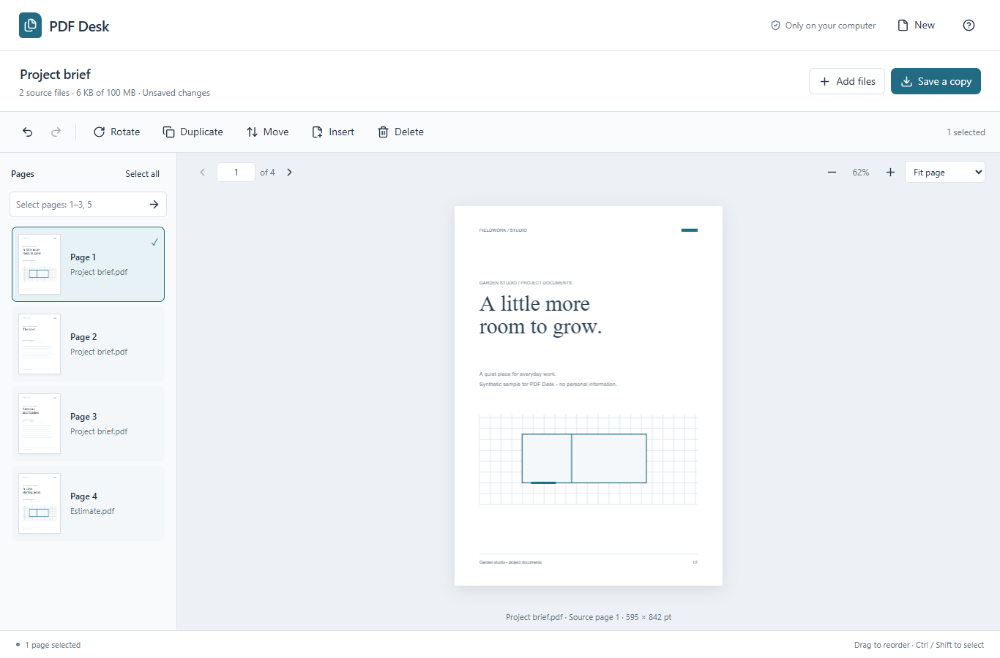

# PDF Desk

**Merge PDFs, rearrange pages, and save a new copy — all on your computer.**

A simple PDF page organiser that runs in your browser. Your files stay local, and your originals stay untouched.

[Download PDF Desk](https://github.com/jackhipperson/pdf-desk/releases/latest) · [User guide](docs/GUIDE.md)

## What you can do

- Combine several PDFs into one document.
- Drag pages into a new order.
- Rotate, duplicate or delete pages, with undo/redo.
- Add images, blank pages or pages from another PDF.
- Save everything, or export just the selected pages.

## Get started

Requires **Windows** and **Node.js 22.13 or newer**.

1. Download the ZIP from [Releases](https://github.com/jackhipperson/pdf-desk/releases/latest) and extract it.
2. Double-click **Start PDF Desk.cmd**.
3. Add your files, arrange the pages, then choose **Save a copy**.

Works offline. No account, uploads or npm install needed.

**Limits:** 100 MB combined input; regular, unencrypted PDFs. Save before closing or refreshing — sessions aren't restored. This version manages pages; it doesn't edit existing text.

## About the project

Built with JavaScript, PDF.js and pdf-lib, with AI assistance from OpenAI Codex. [Read the project story](docs/PORTFOLIO.md), including the human/AI roles and design decisions.

[Detailed guide and development setup](docs/GUIDE.md) · [Test results](docs/VALIDATION.md) · [Changelog](CHANGELOG.md) · [MIT licence](LICENSE)
